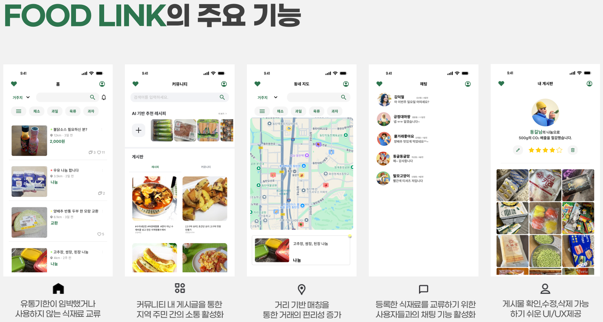

# 🥬 FoodLink

> 남는 식재료를 연결하고, 음식물 낭비를 줄이는 지역 기반 식재료 거래 플랫폼

## 📌 프로젝트 소개

**FoodLink**는 가정에서 사용하고 남은 식재료를 지역 주민들과 
판매, 나눔, 교환할 수 있도록 지원하는 모바일 애플리케이션입니다.

식재료의 과잉 구매와 소비기한 경과로 발생하는 음식물 쓰레기 
문제를 해결하고자 기획하였으며, 지역 기반 식재료 거래와 
커뮤니티를 통해 경제적이고 지속 가능한 소비 문화를 
형성하는 것을 목표로 합니다.

---

## 📅 프로젝트 개요

| 구분 | 내용 |
| --- | --- |
| 프로젝트명 | FoodLink |
| 개발 기간 | 2024년 하반기 |
| 개발 인원 | 4명 |
| 개발 형태 | 팀 프로젝트 |
| 플랫폼 | 모바일 애플리케이션 |
| 담당 역할 | 서비스 기획, UI/UX 디자인, 프론트엔드 개발 |
| 수상 성과 | 교내 창업경진대회 최우수상 |

---

## 💡 기획 배경 및 목적

### Problem

- 식재료의 과잉 구매 및 미사용으로 인한 음식물 쓰레기 발생
- 1인 가구의 식재료 소량 구매에 대한 어려움
- 소비기한이 임박한 식재료의 활용 부족
- 지역 주민 간 식재료를 공유할 수 있는 서비스 부족

### Solution

- 사용자 간 식재료 판매, 나눔 및 교환 서비스 제공
- 지역 및 거리 기반의 식재료 거래 환경 구축
- 레시피 공유 및 추천을 통한 잉여 식재료 활용
- 지역 커뮤니티 활성화를 통한 지속 가능한 소비 문화 형성

---

## 📱 주요 기능 및 서비스 화면

  

### 01. 식재료 거래

- 소비기한이 임박했거나 사용하지 않는 식재료 거래
- 판매, 나눔, 교환 형태의 식재료 게시글 제공
- 식재료 카테고리별 탐색 및 검색
- 사용자 위치와 거래 게시물 간 거리 정보 제공

### 02. 커뮤니티 및 레시피 추천

- 식재료 활용을 위한 AI 기반 레시피 추천
- 사용자 간 레시피 및 요리 정보 공유
- 커뮤니티 게시글을 통한 지역 주민 간 소통

### 03. 동네 지도

- 지도 기반 주변 식재료 거래 게시물 확인
- 거리 기반 매칭을 통한 거래 편의성 향상
- 사용자 주변의 거래 가능한 식재료 탐색

### 04. 채팅

- 식재료 거래를 위한 사용자 간 채팅
- 거래 조건 및 장소, 일정 조율
- 사용자 간 원활한 소통 지원

### 05. 마이페이지 및 게시물 관리

- 사용자 프로필 및 개인 게시물 확인
- 등록한 게시물 수정 및 삭제
- 사용자 거래 평가 확인
- 식재료 나눔에 따른 탄소 배출 절감 효과 시각화

---

## 🛠️ 기술 스택

### Frontend

### Backend & Database

### Version Control & Collaboration

---

## 👩‍💻 담당 역할 및 기여도

### 1. 서비스 기획

- 음식물 쓰레기 및 식재료 낭비 문제를 기반으로 서비스 기획
- 지역 기반 식재료 거래 서비스의 핵심 기능 정의
- 사용자 이용 시나리오 및 서비스 흐름 설계
- 팀원과의 아이디어 구체화 및 개발 방향 수립

### 2. UI/UX 디자인

- 애플리케이션 전반의 UI/UX 디자인 주도
- 홈, 커뮤니티, 동네 지도, 채팅, 마이페이지 등 
  주요 서비스 화면 설계
- 서비스 특성을 반영한 색상 및 디자인 콘셉트 설정
- 사용자 접근성과 편의성을 고려한 인터페이스 구성
- 화면 간 일관성을 유지하기 위한 디자인 요소 설계
- 직관적인 식재료 탐색 및 거래 사용자 경험 설계

### 3. 프론트엔드 개발

- React Native 기반 모바일 애플리케이션 개발
- UI/UX 디자인 결과물을 실제 애플리케이션 화면으로 구현
- 주요 서비스 화면 및 UI 컴포넌트 개발
- 화면 간 이동 및 사용자 인터랙션 구현
- 팀원과의 기능 통합 및 애플리케이션 테스트 참여

---

## 📂 프로젝트 구조

    FOODLINK_1212/
    ├── App/
    ├── public/
    ├── start-expo/
    ├── App.js
    ├── firebase.js
    ├── cloudinaryConfig.js
    ├── firebase.json
    ├── firestore.rules
    ├── storage.rules
    ├── package.json
    └── README.md

---

## 🚀 실행 방법

### 1. 저장소 복제

    git clone https://github.com/jinyoung114/FOODLINK_1212.git
    cd FOODLINK_1212

### 2. 패키지 설치

    npm install

### 3. 애플리케이션 실행

    npx expo start

※ 정상적인 서비스 이용을 위해 Firebase 및 Cloudinary 
환경 설정이 필요할 수 있습니다.

---

## 🏆 프로젝트 성과

### 교내 창업경진대회 최우수상

- 환경 문제 해결을 위한 IT 기반 서비스 모델 제안
- 식재료 거래 및 지역 커뮤니티 서비스 기획
- 서비스 아이디어를 실제 모바일 애플리케이션으로 구현
- 서비스 기획, 디자인, 개발 전반에 걸친 협업 경험

---

## 🌱 기대 효과

| 구분 | 기대 효과 |
| --- | --- |
| 환경적 효과 | 음식물 쓰레기 및 식재료 폐기 감소 |
| 경제적 효과 | 식재료 구매 비용 절감 |
| 사회적 효과 | 지역 주민 간 교류 및 커뮤니티 활성화 |
| 사용자 편의성 | 지역 기반 식재료 탐색 및 거래 편의성 향상 |

---

## 📖 프로젝트를 통해 얻은 경험

- 사회적 문제를 분석하고 소프트웨어 서비스로 구체화하는 경험
- 서비스 기획부터 UI/UX 디자인, 개발까지의 전반적인 과정 경험
- 사용자 중심의 인터페이스 및 서비스 흐름 설계 경험
- React Native 기반 모바일 애플리케이션 개발 역량 향상
- 팀 프로젝트를 통한 역할 분담, 의사소통 및 협업 역량 향상
